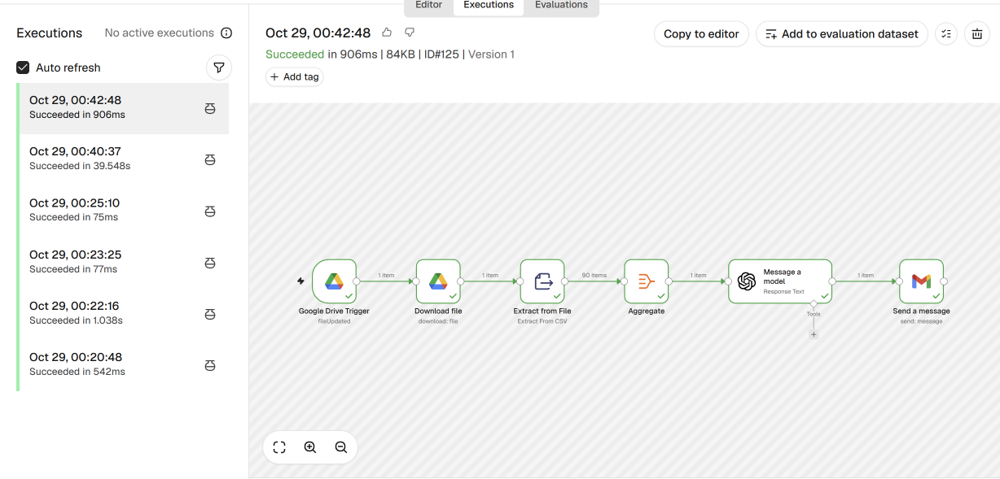

# n8n AI Automation Projects

A collection of automations and AI agents built with [n8n](https://n8n.io), each solving a real-world problem.

| Project | What it does | Key concepts |
|---|---|---|
| [AI Sales Analyst](#1-ai-sales-analyst) | Upload a sales CSV to Google Drive, get an analysis report by email | Data pipeline, Aggregate, LLM prompting, HTML email |

---

## 1. AI Sales Analyst

**The problem:** A small store owner has a monthly sales file, but analyzing it manually takes hours.

**The solution:** Drop the file into a Google Drive folder. One minute later, a clear report with key numbers, insights, and recommendations arrives by email.

### Workflow



```
Google Drive Trigger → Download File → Extract from File → Aggregate → AI Model → Gmail
```

| Step | Node | Why |
|---|---|---|
| 1 | **Google Drive Trigger** | Starts when a new file is added to the folder |
| 2 | **Download File** | Brings the file into n8n |
| 3 | **Extract from File** | Turns the CSV into items (one per order) |
| 4 | **Aggregate** | Combines all items into one, so the model sees the whole dataset at once (90 items → 1 item) |
| 5 | **AI Model** | Analyzes the data using a structured prompt and returns a ready HTML report |
| 6 | **Gmail** | Sends the report as an HTML email |

### Result

<p align="center">
  
  
  
</p>

<details>
<summary><b>See the full report</b></summary>
<br>
<p align="center">
  
  
  
  
  
  
  
</p>
</details>

Uploading a different month's file produces a different report automatically, with no changes to the workflow.

### Prompt design

The prompt follows five elements: **Role, Context, Task, Constraints, Format**. It describes every column, asks numbered analytical questions, forbids invented data, and requires HTML output only.

Full prompt: [`sales-analysis/prompt.md`](sales-analysis/prompt.md)

### Try it

1. Import [`sales-analysis/workflow.json`](sales-analysis/workflow.json) into n8n.
2. Connect your Google Drive, Gmail, and AI model credentials.
3. Set the Drive folder in the trigger and your email in the Gmail node.
4. Upload one of the files in [`sales-analysis/sample-data/`](sales-analysis/sample-data/) to the folder.

---

## Tech stack

- **n8n** for workflow automation
- **OpenAI / LLM** for data analysis and report generation
- **Google Drive, Gmail** as integrations
- **Prompt engineering** with structured prompts

## Notes

- Sample data is synthetic and created for demonstration.
- The workflow file contains no credentials. Connect your own accounts after importing.

## Author

**Sarah Alharthi**: Computer Science graduate, King Abdulaziz University. Interested in data analysis, automation, and building AI agents.